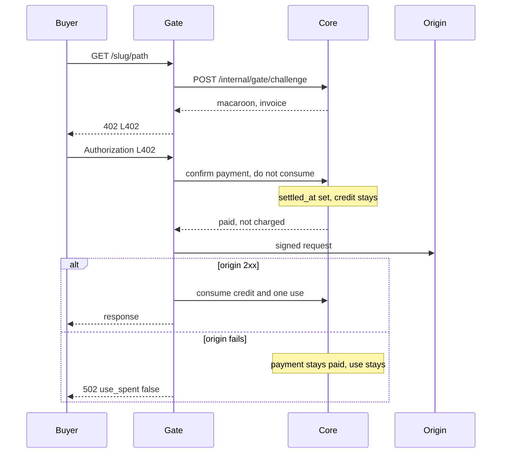
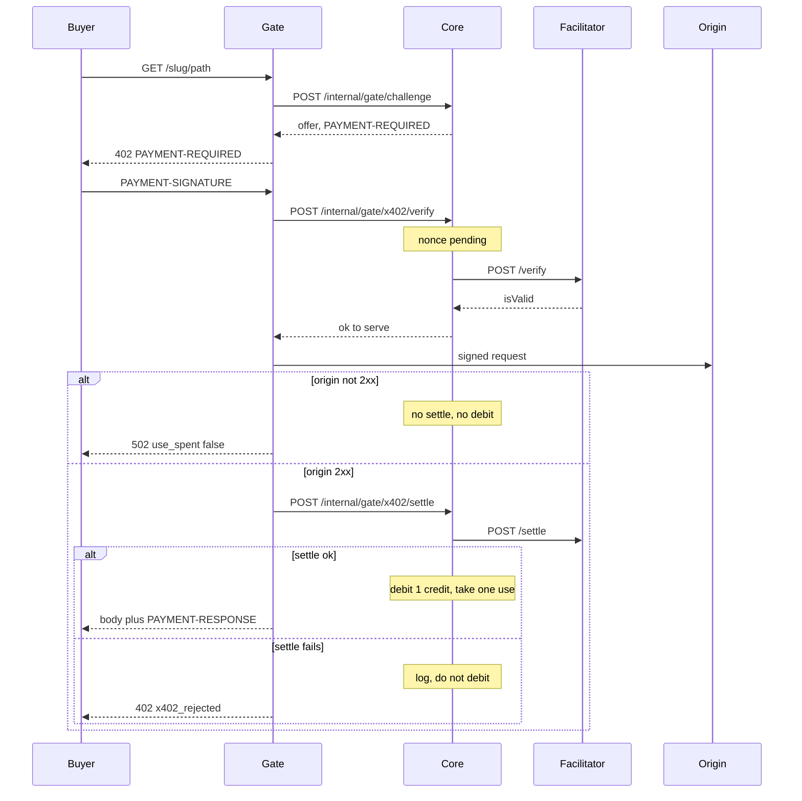
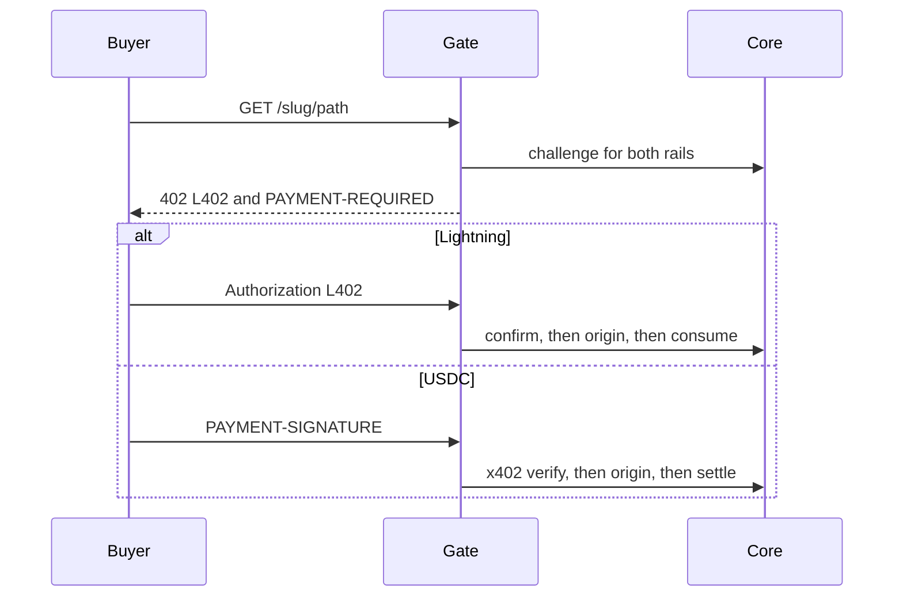
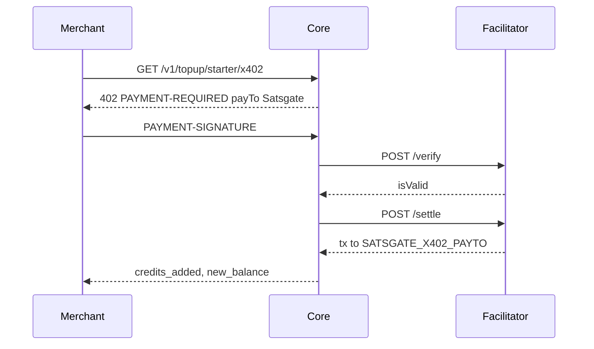

# x402 v2 on Satsgate (USDC on Base)

Design only. This document does not change the server, the database, or any response. The tables and endpoints below are the ones a later pull request would edit. Core is 0.11.0. The hosted gate and satsgate-mcp are as on `main`. The self-hosted proxy is 0.8.0.

The protocol is [x402 v2](https://github.com/x402-foundation/x402/blob/main/specs/x402-specification-v2.md) over HTTP: a 402 carries `PAYMENT-REQUIRED`, the buyer retries with `PAYMENT-SIGNATURE`, and a successful response carries `PAYMENT-RESPONSE`. The only scheme in the first cut is `exact` with EIP-3009 (`transferWithAuthorization`). The only asset is USDC. The only networks are Base Sepolia (`eip155:84532`) and, behind a flag, Base (`eip155:8453`).

## 1. Goals and non-goals

A buyer can pay a hosted-gate route, a self-hosted proxy route, or a Satsgate credit pack with USDC on Base, using a third-party facilitator. The merchant picks the rail and the currency. Satsgate still charges one of the merchant's credits per successful unlock, on either rail.

Non-goals for the first cut:

- Satsgate does not run a facilitator, a relayer, or a wallet. It does not sign, broadcast, or sponsor a transaction.
- No Polygon, Solana, or MPP. The data model has a network and a scheme column so those can be added later without a new table.
- No conversion of funds. The merchant is paid whatever the buyer sent. Satsgate does not swap USDC for sats or the reverse.
- The first x402 pull requests do not change Lightning debit timing. That change is its own later PR (section 11). The rule, once it lands, is the same on both rails.
- Lightning-only callers keep working. A 402 that also offers x402 still has `WWW-Authenticate: L402` and `error: payment_required`.

## 1.1 Decisions

1. **Credit timing, both rails.** The merchant's credit and the use counter move only after a successful origin response. Today `settle_and_consume` debits before `forward()`, and a failed origin still returns `use_spent: true`. That stays until the Lightning PR in section 11. On x402, credit and use also wait for a successful `/settle` (section 3.2). A failed origin consumes neither.
2. **x402 flow.** Offers use the standard `exact` flow: facilitator `/verify`, then the origin, then `/settle`. Not `upfront`. A later per-site setting may advertise `upfront`. The first cut has no such column.
3. **USDC credit packs.** Each plan has a fixed USD price, not a BTC median. The amounts are decided in Etapa 4 pricing. Testnet uses placeholder values. This is decided later, not open.

## 2. What the code does today

Lightning paywall challenges are minted in `app/main.py` `_issue_paywall_challenge` and stored in `paywall_challenges` (`app/db.py`). The payee is `clients.payee_lightning_address`, set by `POST /v1/client/payee` or on the first challenge. Unlock goes through `_unlock_paywall` into `app/db_verify.py` `settle_and_consume`. That function inserts `verifications` (unique on `client_id, payment_hash`) and debits `clients.credits` in the same transaction, then the caller serves. One credit per payment hash, on the first settled unlock. `ledger.reason` is `paywall_verify`.

Hosted routes live in `sites` and `site_routes`. `site_routes.price_sats` is `NOT NULL` and at least 1 (`app/db_sites.py` `clean_price`). The public directory (`GET /v1/sites`, `_site_public`) returns `price_sats`, `max_uses`, and `access_seconds`. It does not return the Lightning address. The gate (`gate/src/satsgate_gate/app.py` `_challenge_response`) asks core `POST /internal/gate/challenge` and returns HTTP 402 with `WWW-Authenticate` and a JSON body. After `POST /internal/gate/verify` or `GET /internal/gate/status/{payment_hash}` succeeds, `forward()` calls the origin. If the origin then fails, the response sets `use_spent: true` (`gate/src/satsgate_gate/forward.py`). The credit is already gone. `gate/src/satsgate_gate/headers.py` drops the buyer's L402 `Authorization` before the origin sees it.

The proxy (`proxy/src/satsgate_proxy/`) does the same shape against `POST /v1/paywall/challenge` and `/v1/paywall/verify`, with prices in YAML (`price_sats`, `access`). satsgate-mcp parses only the L402 header and the JSON sats fields (`mcp/src/satsgate_mcp/challenge.py`). Its budget (`mcp/src/satsgate_mcp/budget.py`) is in sats.

Credit packs are `app/plans.py`. Every plan has `price_sats` and `credits`. `GET /v1/topup/{plan_id}` sells them for Lightning into `topups`, then credits `ledger`.

## 3. Payment flows

x402 uses the standard `exact` flow (`authorization`): facilitator `POST /verify`, then the origin, then `POST /settle`. The offer does not set `extra.paymentFlow`. Clients that speak the default flow can pay. `upfront` (settle, then serve) is a possible later per-site setting. It is not offered in the first cut.

The residual risk is accepted. `/settle` can fail after the origin has already run (facilitator reject, timeout, or the balance disappearing inside `validBefore`). Mitigations: `/verify` first, so a bad signature or an empty balance never reaches the origin; a short offer window; if settle fails, do not consume the credit or the use, and log the offer id, nonce, facilitator status, and short reason. Satsgate does not refund and does not try a second facilitator. Custody is unchanged: USDC still moves from the buyer to the merchant's `payTo` inside the facilitator's transaction. Satsgate does not receive it.

Lightning money already moves when the invoice is paid, to `clients.payee_lightning_address`, before the origin runs. The Lightning PR does not change that. It changes only when the Satsgate credit and the use counter move.

The facilitator is not us. Testnet calls the public x402.org facilitator, which must advertise `exact` on `eip155:84532` from `GET /supported`. Mainnet calls the Coinbase CDP facilitator only when `SATSGATE_X402_CDP=1`. The default is off. Core is the only process that holds facilitator credentials and the only process that calls `/verify` or `/settle`. The gate and the proxy call core, the same way they call `_unlock_paywall` today.

USDC contracts are fixed in config, not taken from the buyer or the merchant:

- Base Sepolia `eip155:84532`: `0x036CbD53842c5426634e7929541eC2318f3dCF7e` (the address in the v2 exact-EVM examples).
- Base `eip155:8453`: `0x833589fCD6eDb6E08f4c7C32D4f71b54bdA02913`.

`extra.name` is `USDC` and `extra.version` is `2`. `extra.assetTransferMethod` is `eip3009`.

### 3.1 Lightning only

The 402 is unchanged: `WWW-Authenticate`, no `PAYMENT-REQUIRED`. Unlock is still the macaroon plus a preimage, or the LUD-21 verify URL when the payee advertises it. Until the Lightning PR, `settle_and_consume` still debits before `forward()`.

Target, in that later PR:

Core checks that the merchant has at least one credit before the origin call, and does not debit it. `settled_at` is set when the preimage or LUD-21 confirms. `verifications` and `uses_consumed` are written only after origin 2xx, in one `IMMEDIATE` transaction, the same conditional update that stops two workers taking the last use. The loser gets `token_used_up` and is not charged.

A retry sends the same macaroon. If `settled_at` is set, core does not mint a new invoice and does not poll the wallet again. No `verifications` row means the credit was not taken, so a previous origin failure is retried. The first 2xx debits once. `UNIQUE(client_id, payment_hash)` makes a second debit a no-op. A grant that is already used up or expired is still a fresh 402 with `reason=token_used_up` or `token_expired`, and the origin is not called. That path does not run after an origin failure, because the use was not taken. A crash after a 2xx and before the debit is the same as a failure: the retry serves again and debits once.

### 3.2 x402 only

No Lightning invoice is minted. Core still writes an offer row (section 4) so the price, `payTo`, and expiry are fixed before the buyer pays.

The gate holds the origin body until `/settle` returns. A failed settle is a 402 to the buyer. The origin has already run. That is the accepted risk. Credit and use move only after settle succeeds.

A retry after an origin failure uses the same `PAYMENT-SIGNATURE`, does not call `/settle`, and tries the origin again while the offer is valid. A retry after a failed settle calls `/settle` again with the stored requirements. It does not ask the buyer for a new nonce while the row is `pending`. A `settled` nonce does not call `/settle` again, and the debit runs once. A `rejected` verify lets the buyer submit a new authorization.

### 3.3 Both rails

One 402. `WWW-Authenticate` is the L402 challenge. `PAYMENT-REQUIRED` is the x402 offer. The JSON body keeps today's Lightning fields and adds an `x402` object that mirrors the header, so a client that only reads JSON can see both. Both amounts were computed in the same offer and expire together (`invoice_expires_at` and `maxTimeoutSeconds`).

The buyer sends either `Authorization: L402 ...` or `PAYMENT-SIGNATURE`, not both. If both arrive, core rejects the request with 400 `one_rail_only` and does not settle either. Paying one rail does not mark the other rail's quote as paid.

The Lightning branch is the target in section 3.1. The gate PR still calls today's verify or status with `consume=true`.

### 3.4 Credit top-up in USDC

`GET /v1/topup/{plan_id}` stays Lightning and still uses `plans.price_sats`. A new `GET /v1/topup/{plan_id}/x402` sells the same pack for a fixed USD amount to Satsgate's own Base address (`SATSGATE_X402_PAYTO`). The amount is not the BTC median. Real pack prices are decided in Etapa 4. Testnet uses placeholders (every plan `1_000_000` atomic, meaning $1) and those values must not ship as production prices. Satsgate is the merchant of that one route. There is no origin. The flow is `/verify`, then `/settle`, then the ledger write. Credits are applied only after settle succeeds. Core never receives the USDC. Credits are not transferred and are not redeemable for money. A failed facilitator response adds nothing.

If the process dies after settle and before the ledger write, the nonce row (inserted before `/verify`, section 7) is how a retry finds the tx and finishes the credit without a second charge.

## 4. Data model

No migration ships with this document. The next implementation PR adds columns and one new table. Existing rows stay valid. `price_sats NOT NULL` cannot be relaxed with `ALTER TABLE` in SQLite, so a USD-priced route needs a table rebuild of `site_routes` in that later PR, or a new amount column plus a check that USD-main routes do not pretend `price_sats` is the source of truth. The rebuild is the one described here. It copies rows and does not change Lightning behavior.

`clients` (account, not the restricted `api_keys` table):

| Column | Purpose |
| --- | --- |
| `payee_evm_address` | Checksummed `0x` address. Null until set. |
| `payee_evm_verified_at` | Unix time. Null means x402 cannot be turned on. |
| `payee_evm_message` | Exact EIP-191 string the server asked them to sign. |
| `payee_evm_signature` | The signature. Not a secret, but not returned in the public directory. |

Changing the address clears `payee_evm_verified_at` and turns `sites.rail_x402` off for that client until a new signature verifies. This mirrors the rule that a client has one Lightning payee, but a change does require a new proof. `POST /v1/client/payee` does not start accepting an EVM address in the same field.

`sites`:

| Column | Purpose |
| --- | --- |
| `rail_lightning` | Integer, default 1. Existing sites stay on Lightning. |
| `rail_x402` | Integer, default 0. |

x402 cannot be set to 1 unless `payee_evm_verified_at` is set and the facilitator flag for that network is on. Disabling a site (`status` not `approved`) already hides it. Rails do not override that.

`site_routes`:

| Column | Purpose |
| --- | --- |
| `price_currency` | `sats` or `usd`. Default `sats`. |
| `price_usd_atomic` | USDC atomic units (6 decimals) when USD is the main price. Null when the main price is sats. |

`price_sats` remains the main price when `price_currency` is `sats`. When `price_currency` is `usd`, `price_usd_atomic` is the main price and `price_sats` is not the quote. The public directory and the gate must not display `price_sats` as the live sats price for a USD route. The live number is locked on the offer, not on the route.

New table `payment_offers`, one row per issued 402:

| Column | Purpose |
| --- | --- |
| `id` | Primary key. Not a Lightning payment hash. |
| `client_id`, `resource`, `api_key_id` | Same meaning as `paywall_challenges`. |
| `price_currency` | Which price was the merchant's. |
| `amount_sats`, `amount_usd_atomic` | Locked quotes. Null if that rail was not offered. |
| `rate_num`, `rate_den`, `rate_fetched_at` | The median used, if any. Null when only the main currency was offered. |
| `expires_at` | Shared window. Lightning invoice expiry and x402 `maxTimeoutSeconds` end here. |
| `max_uses`, `access_seconds` | Copied from the route, as today. |
| `payment_hash` | Set when a Lightning invoice was minted. Unique when not null. Points at `paywall_challenges`. |
| `network`, `asset`, `pay_to` | Copied from config and the verified address. Null when x402 was not offered. |
| `buyer_ip_hash` | Same HMAC as `paywall_challenges.buyer_ip_hash`. |

`find_reusable_paywall_challenge` matches amount, payee, resource, and policy for `SATSGATE_CHALLENGE_REUSE_SECONDS` (default 30). Reuse for a dual offer must load this row and return the locked amounts. It must not recompute the rate. A reused Lightning invoice keeps its existing `payment_hash`.

New table `x402_authorizations`, the replay record:

| Column | Purpose |
| --- | --- |
| `network`, `asset`, `payer`, `nonce` | Unique together. The EIP-3009 nonce is 32 bytes. |
| `offer_id` | The offer that was paid. |
| `value_atomic`, `pay_to` | What we required. Checked before `/verify` and again before `/settle`. |
| `state` | `pending`, `verified`, `settled`, or `rejected`. |
| `tx_hash`, `settled_at` | From the facilitator. Empty until settle succeeds. |
| `credit_charged` | 0 until settle has succeeded and, for a gate or proxy route, the origin returned 2xx. |
| `uses_consumed`, `access_until` | Same grant rules as `paywall_challenges`. Written with the credit, not before. |

Insert `pending` before `/verify`. Two workers cannot both verify one nonce. Verify failure marks `rejected` and does not call the origin. Origin failure leaves `pending` and does not call `/settle`. Settle success stores the tx, then the same transaction debits the credit and takes the use. Settle failure after a 2xx leaves the credit and the use alone and writes a log line. `verifications` stays the Lightning once-per-hash record, inserted by the Lightning PR only after origin 2xx. It is not a nonce table.

`topups` gains `rail` (`lightning` or `x402`, default `lightning`), `tx_hash`, and `amount_usd_atomic`. `payment_hash` stays unique for Lightning. x402 top-ups use `tx_hash` as their unique ref. `ledger.ref` is that tx hash.

`app/plans.py` gains a fixed `price_usd_atomic` per plan when the top-up PR lands. That number is not the BTC median. The median is only for a route whose other rail is derived. Production amounts wait for Etapa 4. Until then the column is a testnet placeholder.

## 5. API

Merchant account, all on the account key. A restricted `sgr_` key cannot set a payee or a rail (`app/db_keys.py` already refuses payee changes for a non-account scope).

- `POST /v1/client/payee/evm/challenge` returns a one-time message: domain, client id, checksummed address, nonce, expiry. Nothing is written on chain.
- `POST /v1/client/payee/evm` sends the address and the EIP-191 signature of that exact message. Core recovers the address and sets `payee_evm_verified_at`. A wrong signer, a stale nonce, or a different message is 400 and does not change the stored address.
- `PATCH /v1/sites/{slug}` accepts `rail_lightning` and `rail_x402`. Turning x402 on without a verified address is 400 `payee_evm_not_verified`. Turning both off is 400. Default for a new site is Lightning on, x402 off.
- `POST /v1/sites/{slug}/routes` and the route `PATCH` accept `price_currency` (`sats` or `usd`) and, when USD, `price_usd_atomic`. `price_sats` stays required for a sats-priced route. Bounds stay inside `clean_price` for sats. USD must be at least 1 atomic unit and at most a config cap (proposed `$1,000`, `100_000_000` atomic, so a typo cannot quote a fortune).

`GET /v1/sites` adds, per route, `price_currency` and `price_usd_atomic` when that is the main price. It does not add `payTo`. The gate URL stays `url`. Derived prices are not listed, because they move. The 402 is where the locked quote appears. satsgate-mcp `list_sites` (`mcp/src/satsgate_mcp/registry.py`) will pass those fields through in the MCP PR. Until then, unknown JSON fields are already ignored.

402 from the gate (`_challenge_response`) and from the proxy (`proxy/src/satsgate_proxy/app.py` `_challenge_response`):

- Status 402, `Cache-Control: no-store` on the gate, as today.
- Lightning enabled: today's JSON (`amount_sats`, `invoice`, `payment_hash`, `macaroon`, `max_uses`, `access_seconds`) and `WWW-Authenticate`.
- x402 enabled: header `PAYMENT-REQUIRED`, base64 of the v2 `PaymentRequired` object. `accepts` has one entry. `resource.url` is the buyer-facing URL (`GATE_PUBLIC_BASE` plus slug plus path, or the proxy's own URL). `maxTimeoutSeconds` is `expires_at - now`, at least 1, and not longer than the offer. `amount` is a decimal string of atomic units. `payTo` is the verified address, or `SATSGATE_X402_PAYTO` for a credit top-up.
- Body field `x402` repeats `network`, `asset`, `amount`, `payTo`, `expires_at`, and `scheme`, so logs and the MCP do not have to decode the header to display a price. The header is the canonical object. If they ever disagree, the header wins and core treats that as a bug.

`PAYMENT-SIGNATURE` is base64 of the v2 `PaymentPayload`. Core, not the gate, checks it:

- `accepted` matches the stored offer: scheme `exact`, network, asset, payTo, amount, and `maxTimeoutSeconds` still inside `expires_at`.
- `payload.authorization.to` equals payTo, `value` equals the locked amount, `validBefore` is not after the offer expiry, and `from` is a checksummed address.
- The EIP-712 domain name and version are the USDC values we put in `extra`, not values the buyer invented.
- The nonce is 32 bytes and not already `settled` for that network, asset, and payer.

Core then calls facilitator `/verify` with the stored requirements, not the buyer's copy. `isValid: false` is 402 `x402_rejected`. `invalidReason` is passed through only if it is a short token (`[a-z0-9_]{1,64}`). The nonce is `rejected`, the origin is not called, and the buyer can submit a new authorization. A verify timeout or a non-JSON body is 502 `paywall_unavailable`, the same shape as a Lightning provider failure in `_lud21_state`, and the nonce stays `pending`.

On verify success the gate calls the origin. A non-2xx does not call `/settle`. On 2xx the gate calls core again, and core calls `/settle` with the stored requirements. `success: false` is 402 `x402_rejected`, the origin body is not returned, and the credit and the use stay put. The log line is the offer id, the nonce, the HTTP status, and the short reason. A settle timeout leaves `pending` (the tx may have landed). A retry of the same payload looks the row up and does not start a second payment. Only a `rejected` row allows a new nonce.

`PAYMENT-RESPONSE` is the base64 settle result (`success`, `tx`, `network`, `payer`) on the buyer response that carries the origin body. It is not sent on the 402 or the 502.

Internal gate (`app/internal_gate.py`): `POST /internal/gate/challenge` keeps its body (`slug`, `path`) and returns both offers. New `POST /internal/gate/x402/verify` and `POST /internal/gate/x402/settle` take the same gate token and `SATSGATE_GATE_PEERS` check. The gate does not receive `SATSGATE_X402_CDP_*`. Public OpenAPI continues to omit `/internal/*`. The Lightning consume-after-origin call is added in the Lightning PR, not here.

Proxy YAML (`proxy/src/satsgate_proxy/config.py`) later gains `price_currency`, `price_usd`, and `rails`. Until that PR, the proxy is Lightning only. When it lands, the proxy forwards `PAYMENT-SIGNATURE` to core and copies `PAYMENT-REQUIRED` and `PAYMENT-RESPONSE`. It strips both before the origin, next to the L402 `Authorization` drop.

Caddy (`Caddyfile`) strips `X-Satsgate-Buyer-Ip` and must keep doing that. It must not strip `PAYMENT-SIGNATURE`, `PAYMENT-REQUIRED`, or `PAYMENT-RESPONSE`. Those headers are larger than an L402 macaroon. The gate's request-size cap does not apply to headers. Implementation should reject a `PAYMENT-SIGNATURE` over 8 KB before calling core.

## 6. Rates

A route has one main price, chosen by the merchant, stored on `site_routes`. The other rail, if enabled, is a quote.

Core refreshes a median about once a minute from two or three public BTC/USD sources. Proposed sources, all unauthenticated GETs: Coinbase spot `BTC-USD`, Kraken `XBTUSD`, and Bitstamp `btcusd`. Each source has its own timeout (2 seconds). The median of the sources that answered is the rate. One source is not enough. Two or three are required. The refresh task lives in the core process, next to the existing startup in `app/main.py`. It does not run in the gate.

The rate is stale at 3 minutes. Stale, empty, or non-numeric means the derived rail is omitted. The main currency is still offered. A 402 never includes a guessed price. The offer row stores the numerator and denominator actually used (`rate_num` / `rate_den` as integers of USD per BTC scaled by 10^8) and `rate_fetched_at`. Settle checks the locked amount, not a new fetch.

Rounding, proposed and called out in section 12:

- Derived USDC rounds to the nearest 0.0001 USDC (100 atomic units). A result below 0.001 USDC (1000 atomic) is treated as unusable, and only the main currency is offered.
- Derived sats round to the nearest sat, minimum 1 sat. A result that would be 0 is unusable the same way.

The gate's site cache (`SATSGATE_GATE_CACHE_SECONDS`, default 5) may cache the route's main price. It must not cache a derived quote. The quote is created inside the challenge call and stored on `payment_offers`.

Satsgate never converts a settled payment. If the buyer pays the USDC amount, the merchant's verified address receives USDC. If the buyer pays the invoice, the Lightning address receives sats.

## 7. Security

- Signature check for payTo is EIP-191 over the server's message. The message includes a nonce stored on the client row and an expiry of 10 minutes. The recovered address must equal the address in the body. No on-chain call.
- Replay is the unique `(network, asset, payer, nonce)` row, inserted before `/verify`. The on-chain nonce is the backstop. The row stops two gate workers. An origin failure skips `/settle`. A settle timeout retries `/settle` on the same row. Lightning replay is the payment hash: `settled_at` means the invoice is paid, and `verifications` means the credit was taken. A second presentation of the same proof does not debit twice.
- Amount, asset, network, and payTo are compared to the offer and to the hardcoded USDC address for that network. A mainnet payload is rejected while `SATSGATE_X402_CDP` is off, even if the signature is valid.
- `validBefore` must fall inside the offer window. An authorization that is valid for longer than `maxTimeoutSeconds` is rejected, so a buyer cannot reuse a signature after the locked price has expired.
- Limits: the existing per-buyer challenge caps (`SATSGATE_BUYER_CHALLENGE_MAX`, `SATSGATE_BUYER_MAX_OPEN_CHALLENGES`) apply to offers. x402 settle is not a way around them. Facilitator calls use a 10 second timeout, no redirects, and the existing SSRF guard (`app/ssrf.py`) even though the URL is ours.
- Secrets: `SATSGATE_X402_CDP_KEY_ID` and `SATSGATE_X402_CDP_KEY_SECRET` are read from the environment in `app/config.py`, the same pattern as `SATSGATE_GATE_TOKEN`. They are not logged, not put in `/health`, not put in the manifest, and not passed to the gate container in `docker-compose.yml`. A log line for a facilitator error records the HTTP status and the short reason token, not the request body. The buyer's EIP-3009 signature is not stored and not logged. The nonce row is the replay key.
- The gate still strips `Authorization` and `X-Satsgate-*` toward the origin. It will also strip `PAYMENT-SIGNATURE`. The origin does not need the buyer's USDC signature. `X-Satsgate-Paid-Sats` stays the sats figure when the buyer paid Lightning. A USDC payment sends `X-Satsgate-Paid-Usd-Atomic` instead, and does not invent a sats amount in that header.

## 8. Regulatory design constraints

These are constraints on the design, not a legal opinion. `docs/hosted-gate-terms.md` is still a draft. The paragraphs in section 9 are what a later edit of that draft should add.

Satsgate does not custody buyer funds. It does not receive them, forward them, or refund them. A Lightning payment goes to `clients.payee_lightning_address`. A USDC payment goes to `payee_evm_address` or, for a credit pack only, to `SATSGATE_X402_PAYTO`. The facilitator submits the transaction. Satsgate does not.

Satsgate does not run a facilitator or a relayer. Configuring our own `/settle` that signs with a Satsgate key would cross this line.

Credits are closed-loop. They are not a balance the merchant can withdraw, transfer to another client, or redeem for sats or USDC. A refund, if one is ever given, is more credits on `ledger`, not a payment. The existing top-up path already works this way.

Buyer funds go from the buyer to the merchant. On Lightning that is the invoice to `payee_lightning_address`. On x402 that is the facilitator's `/settle` to `payTo`. Satsgate does not sit in that path. The standard flow calls the origin before `/settle`. If the origin fails, `/settle` is not called. If `/settle` fails after the origin has run, the merchant's credit is not taken and the failure is logged. Any remedy for that unpaid origin work, or for sats already paid on Lightning, is between the buyer and the merchant. Satsgate does not refund.

Changes that would cross the line, and should be rejected or sent for a new decision:

- A Satsgate-operated facilitator, relayer, paymaster, or hot wallet that submits user transactions.
- Taking buyer USDC into a Satsgate address and then paying the merchant (a split, a fee skim, or a swap).
- An automatic refund transaction to the buyer.
- Letting a merchant withdraw or transfer credits as money.
- Marketing the gate as anonymous. It is not. The facilitator can reject a payment, and we store payment hashes, tx hashes, and a hash of a truncated buyer IP.
- Enabling x402 for a site that is not approved, or leaving it on after `status` leaves `approved`.

The facilitator may refuse a payment (sanctions or KYT). That refusal is a failed payment. Core does not retry it on another facilitator, and does not serve the origin.

## 9. Terms to add later

Not edited in this pull request. When the draft terms are next updated, add:

- USDC payments depend on a third-party facilitator. That facilitator can reject a payment, including after the origin has been called. Satsgate does not control that decision, does not complete the payment itself, and does not refund.
- Sites may not offer illegal or sanctioned content or services. Satsgate may disable a site on an abuse report, as it already may for the other prohibited uses.
- Credits are not money. They cannot be transferred or cashed out. A refund from Satsgate, if any, is credits only.
- Do not describe the service as anonymous. Payment hashes, settlement transaction ids, and a rate-limit hash of the buyer IP are stored.

## 10. Testing

Unit tests, with the facilitator HTTP mocked, the same style as `tests/test_satsgate_gate.py`:

- x402 off by default. A site with only Lightning is byte-for-byte the current 402 (no `PAYMENT-REQUIRED`).
- Unverified EVM address cannot enable the rail. A new signature is required after the address changes. A signature over the wrong message does not verify.
- Derived rail omitted when the rate fixture is stale or has one source. Main price still returned. Stored offer amount does not change if the fixture rate changes before settle.
- Settle checks amount, asset, network, payTo, and expiry. A mutated payload does not reach the facilitator.
- The offer has no `paymentFlow: upfront`.
- Replay: a second settle of a `settled` nonce does not call the facilitator and does not debit twice.
- `/verify` with `isValid: false` does not call the origin or `/settle`, and does not debit.
- Origin 500 after a valid verify: no `/settle`, no debit, `uses_consumed` stays 0, retry serves.
- Origin 2xx then `/settle` `success: false`: buyer gets 402, no debit, a log line exists, retry calls `/settle` once more and then debits once.
- Lightning PR: payment confirmed, origin 500, credit unchanged, `use_spent` false, retry of the same macaroon debits once. A used-up grant is still `reason=token_used_up`.
- Dual header present, and `one_rail_only` when both payment headers are sent.
- CDP flag off: `eip155:8453` is rejected. Flag on: the test double is the CDP base URL, and the key is absent from logs.
- Public `GET /v1/sites` still has no owner, origin, secret, or payTo.

Base Sepolia, private, after the gate PR: a site pointed at a small HTTPS origin the operator runs, rail x402 only, price a few cents of test USDC. Buyer wallet funded from a public faucet. Pay through the x402.org facilitator. Confirm the tx's `to` is the merchant address, not Satsgate, and that the origin saw the signed request without `PAYMENT-SIGNATURE`. Then force the origin to fail and confirm the credit balance did not move and a retry still serves.

Mainnet, last, behind the flag, one route at the smallest sensible USDC amount, one real payment from a wallet the operator controls, then the flag can stay off until that tx looks right.

## 11. Later pull requests

Each one is shippable on its own. None of them is this pull request.

1. Core, testnet only. Offer rows, nonce table, payTo verification, standard `/verify` then `/settle` through the x402.org facilitator, feature flag default off for mainnet. No gate change. A test can call the internal routes. Lightning debit timing stays as it is today.
2. Rates and main currency. Route columns, median refresh, lock on the offer, stale-rate behavior.
3. Gate. Dual 402, header pass-through, private Sepolia test against a real origin. x402 credit and use move only after origin 2xx and settle success. The Lightning path still uses today's `consume=true`.
4. Lightning credit timing, its own small PR. `settled_at` on payment confirmation. Credit and `uses_consumed` only after origin 2xx, in the gate and the proxy. Retry and replay as in section 3.1. No x402 work in this PR.
5. USDC credit top-up to `SATSGATE_X402_PAYTO`. Fixed `price_usd_atomic` on `app/plans.py`, testnet placeholders only. Real amounts wait for Etapa 4.
6. Proxy YAML and the same headers, still talking to core.
7. MCP. Parse `PAYMENT-REQUIRED`, show the USDC amount, and enforce a separate USD cap (`SATSGATE_MCP_MAX_PAYMENT_USD` and a daily cap). Do not pay automatically unless a later, explicit wallet setting exists. The sats caps in `budget.py` do not apply to USDC and must not be reused as if they did.
8. CDP mainnet behind `SATSGATE_X402_CDP`, default off, after the small real payment in section 10. A per-site `upfront` option is not in this list.

## 12. Open questions

Credit timing, the standard x402 flow, and fixed USD pack prices are decisions in section 1.1. Pack amounts are decided later, in Etapa 4. These still need an owner:

1. Rounding. Section 6 proposes 0.0001 USDC steps and a 0.001 USDC floor, and whole sats with a 1 sat floor. A 21-sat route is about two cents at a $100k BTC, so the floor matters for cheap routes.
2. Whether `payTo` may appear on `GET /v1/sites`. This design keeps it off the directory, like the Lightning address, and puts it only in the 402.
3. Whether the MCP may hold a buyer private key. This design says no in the first MCP PR. It returns the payment requirements and enforces a USD cap. A key in the environment would be a separate decision, and it would have to be unread from logs the way `SATSGATE_MCP_NWC_URI` is.
4. Exact facilitator base URLs, confirmed at implementation by `GET /supported`, not hard-coded from memory in this document. Testnet is the public x402.org facilitator. Mainnet is CDP, flag off.
